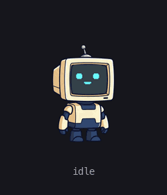
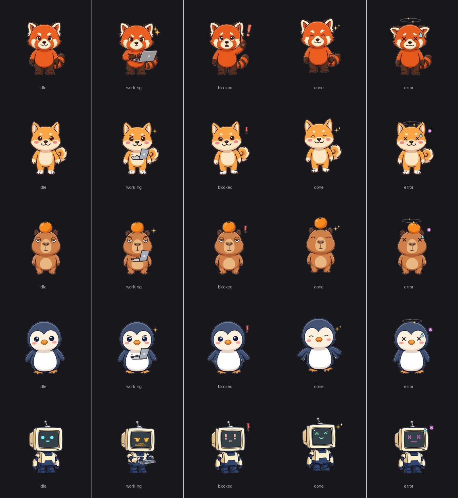

# Rex Pet

An unofficial, ambient desktop pet for [Rex](https://superlogical.com), the terminal workspace
by Superlogical. A small character sits in the corner of your desktop, mirrors what your agent panes
are doing, and — when one of them is blocked waiting for you — lets you answer without switching
panes.



Zero dependencies: plain AppKit, no Xcode project, no third-party packages. `./build.sh` and you have
an `.app`. Five custom characters — a **Retro CRT Robot**, **Red Panda**, **Shiba Inu**, **Capybara**,
and **Penguin** — are bundled in [`Themes/`](Themes/README.md) and switchable right from the **Theme**
menu, alongside the built-in vector cat drawn in code (`CatSprite`).

## Why

Rex already has plenty of ways to show agent state: menu bar monitors, an attention board, a panel
beside the window, even an ESP32 desk display — and floating inboxes that let you answer a waiting
agent. They all want a glance, a list, or a pane.

Rex Pet is the ambient one. A creature sits in the corner of the screen, says what is happening with
colour alone, and answers in one click: hit **Allow (y)** on the pet and the answer goes straight into
the blocked pane. No list, no window to open, nothing to keep an eye on.

## Requirements

| | |
| --- | --- |
| OS | macOS 14 or newer |
| Rex | installed, so that `rex` is on `PATH` (or point `REX_PET_REX_BIN` at it) |
| Toolchain | Xcode Command Line Tools (`swiftc`) — no full Xcode needed |

A GUI-launched app inherits launchd's minimal `PATH`, so the pet looks for `rex` in the usual install
locations (`/opt/homebrew/bin`, `/usr/local/bin`, `~/.local/bin`, …) and inside the Rex app itself
before giving up. If it still cannot find one, the pet says so and offers **"Choose the rex binary…"**
in its menu; the chosen path is remembered. It also keeps retrying every 30 s, so installing Rex
afterwards just starts working.

## Install

Download `RexPet-<version>.zip` from [releases](https://github.com/ziludev/rex-pet/releases) and
drag the app to `/Applications`.

It is ad-hoc signed, not notarized, so the first launch needs one of:

- right-click the app and choose **Open**, then **Open** again, or
- `xattr -dr com.apple.quarantine /Applications/RexPet.app`

Launching from `/Applications` is also what makes **Launch at login** work — the service refuses to
register a bundle that lives in a build directory.

## Build and run

```sh
./build.sh                              # -> build/RexPet.app (host arch)
ARCHS="arm64 x86_64" ./build.sh          # universal binary
open build/RexPet.app
REX_PET_DEBUG=1 ./build/RexPet.app/Contents/MacOS/RexPet   # logs clicks and sends to stderr
```

The bundle is ad-hoc signed (`codesign --force --sign -`), which is enough to run locally and keeps
the TCC identity stable across rebuilds. There is no notarized binary yet.

`tools/release.sh` builds the universal app, runs the checks, and writes `build/RexPet-<version>.zip`
plus its SHA-256 — that is exactly what a release uploads.

## Using it

- **The pet is the only clickable part.** Everywhere else in its window, clicks fall through to
  whatever is underneath: the window polls the mouse position at 20 Hz and flips
  `ignoresMouseEvents`, which needs no accessibility permission.
- **Left click** — idle/working: a bubble naming the state and the pane. Blocked: the reply panel.
- **Drag** — moves the window; the position is remembered in `UserDefaults`.
- **Menu bar icon** — set a state, demo mode, toggle click-through, reset position, reply to the
  blocked pane, pick the `rex` binary, launch at login, quit. The same menu is on a right click.
  The menu bar glyph is a template image, so it follows the light/dark menu bar.

The reply panel is a small HUD that becomes the key window just long enough to type, then hands
focus back to whatever you were using:

| Button | Sends |
| --- | --- |
| Allow (y) | `y\r` |
| Pick 1 | `1\r` |
| Deny (n) | `n\r` |
| Ctrl+C | `\x03` |

On a Chinese system the same buttons read 允许 (y) / 选 1 / 拒绝 (n).
| free text + Enter | the text and `\r` |

Delivery is the same call [rex-beacon](https://github.com/ziludev/rex-beacon) uses:

```sh
rex block call -b <block> write '{"data":"y\r"}'
```

## States


| State | Retro CRT Robot | Built-in Cat | Meaning |
| --- | --- | --- | --- |
| `idle` | cyan pixel eyes glancing & blinking | no halo | nothing is running |
| `working` | typing on keyboard, `LOADING...` bar filling | amber halo, `~` badge | at least one pane is busy |
| `blocked` | flashing coral `! !` eyes, antenna alert | red halo, `!` badge, no blinking | a pane wants permission or an answer |
| `done` | mint `^ ^` celebration hop & stars | green halo, `✓` badge | a command finished, cleared or not |
| `error` | glitching `× ×` screen & sweat drop | magenta halo, `×` badge | a command exited non-zero |

On the built-in vector cat, the body is never tinted: the halo and the badge carry the state, so it
stays one coherent character. On light wallpapers the silhouette survives thanks to a soft drop shadow
and a 1.2 pt translucent outline.

## How it works

```
rex events --all --json
        │
   RexWatcher          parse block events from com.superlogical.terminal
        │
 PetStateMachine       merge panes: blocked > error > done > working, with TTLs
        │
    PetView ──> CatSprite     vector cat, 30 fps, breathing/blinking per state
        │
   ReplyPanel ──> rex block call write ──> the blocked pane
```

The event stream, not a file, is the source of truth:

| Event | Value | State |
| --- | --- | --- |
| `progress_report` | `indeterminate`, `running`, anything else | `working` |
| `progress_report` | `success` / `done` / `complete` | `done` |
| `progress_report` | `error` / `fail…` | `error` |
| `progress_report` | contains `block` / `need` / `wait` / `prompt` | `blocked` |
| `program_status_changed` | `records[].state` (the OSC 7501 vocabulary) | as reported |
| `child_exited` | `exit_code` 0 / non-zero | `done` / `error` |
| `bell` | — | `blocked` |

The last event must not win outright: shells emit `idle` right after `child_exited`, which would
erase the check mark before anyone sees it, and a busy pane in another window would fight a fresh
`done`. So `PetStateMachine` keeps one entry per block, shows the highest priority among them, holds
`done`/`error` for 8 s, and drops `working` after 15 s without a refresh.

Honest consequence: any pane reporting `working` keeps the pet amber. While an agent runs in one of
your panes, the pet is amber — that is a report, not a bug.

## Files it reads and writes

| Path | Purpose |
| --- | --- |
| `~/.cache/rex-pet/state` | manual override: `idle` / `working` / `blocked` / `done` / `error`, wins over the event stream for 60 s after it is written |
| `~/.cache/rex-pet/context.json` | same, plus `{"block":"block:…","title":"…"}` so a demo click has somewhere to reply |
| `~/Library/Application Support/rex-pet/Assets/<state>.mov` | optional clip with alpha, looped; beats PNG frames and the vector cat |
| `~/Library/Application Support/rex-pet/Assets/<state>/*.png` | optional image sequence (12 fps, or 18 fps for 20+ frames); beats bundled default clips |

`./build/RexPet.app/Contents/MacOS/RexPet --selftest` runs the headless checks (state aggregation,
event parsing, asset resolution, reply placement and language switch) and exits non-zero on failure;
CI runs exactly that.

`REX_PET_REX_BIN` overrides the `rex` lookup, `REX_PET_LANG=en|zh` overrides the UI language,
`REX_PET_DEBUG=1` logs to stderr.

## Bundled themes

Five custom animated characters live in [`Themes/`](Themes/README.md) — **Red Panda**, **Shiba Inu**,
**Capybara**, **Penguin**, and **Retro CRT Robot** — each with 24 articulated frames per state (18 fps)
and character-specific animations (wagging tails, flapping wings, bouncing yuzu, live CRT loading bar
& alternating keyboard typing).



Switch themes directly from the **Theme** submenu in the menu bar / right-click menu, or install a
theme as `.mov` clips into `~/Library/Application Support/rex-pet/Assets/`:

```sh
./tools/install-theme.sh retro-robot   # or red-panda, shiba, capybara, penguin
./tools/install-theme.sh --restore-default
```

## Your own art

Any state can be replaced by a clip you generate: a green-screen video in, one HEVC-with-alpha
`.mov` out.

```
tools/make-pet.sh working ~/clip.mp4          # → build/assets/working.mov
cp build/assets/working.mov ~/Library/Application\ Support/rex-pet/Assets/
```

`make-pet.sh` keys out the green, crops and scales to the window, and encodes alpha that AVPlayer
plays natively. Prompt recipes and the full pipeline this borrows from live in
[dsh-pet](https://github.com/PC2005-cloud/dsh-pet) (MIT); see [docs/MAKE-YOUR-OWN-PET.md](docs/MAKE-YOUR-OWN-PET.md).
`tools/render-art.sh` regenerates `docs/states.png` and `docs/demo.gif` from the clips in `Assets/`,
so the README shows what the app actually plays. `tools/render-states.swift`, `tools/render-demo.swift`
and `tools/render-icon.swift` do the same for the drawn cat and the app icon; `tools/style-cat.swift`
is the sketch pad where that cat was designed.

## Known gaps

1. Multiple displays: the default position is pinned to the first screen (`NSScreen.screens.first`);
   after moving the cat, it stays where you left it. Stage Manager and full-screen Spaces untested.
2. `blocked` has no timeout — a pane that reports it once and never retracts keeps the red halo.
3. `write` only reaches **placed** blocks. A block created by `rex new` before any client renders it
   answers `block target "…" not found` (exit 3); a blocked pane is always placed, so this does not
   bite in practice.
4. No preferences window and no per-pane list — one cat, one aggregate state.
5. Only English and Simplified Chinese; every other language falls back to English.
6. **Launch at login** uses `SMAppService`, which wants a real bundle: it works once `RexPet.app` lives in
   `/Applications`, and reports a failure bubble when run from `build/`.

## Related

- [rex-orbit](https://github.com/benhid/rex-orbit) — agent panes as pixel bots orbiting a dinosaur, inside a pane
- [rex-radar](https://github.com/hecspc/rex-radar) — menu bar, widget, iPhone and Watch status
- [rexboard](https://github.com/vanducng/rexboard) — attention board: which panes wait, and for how long
- [cheap-rex-display](https://github.com/yethranayeh/cheap-rex-display) — the same idea on an ESP32 desk display
- [rexq](https://github.com/tfcace/rexq) — floating inbox for questions and decisions from agents
- [Rex's Tail](https://github.com/travelingflwr/rex-tail) — a panel beside Rex showing agent activity
- [dsh-pet](https://github.com/PC2005-cloud/dsh-pet) — the browser pet this borrows its art pipeline from
- [awesome-rex](https://github.com/alpha-og/awesome-rex) — the list all of the above live in

## License

MIT, see [LICENSE](LICENSE). `tools/hevc-alpha-encoder.swift` is adapted from the
[dsh-pet](https://github.com/PC2005-cloud/dsh-pet) / sunkeycn encoder (MIT).

Rex and Rexie are trademarks of Superlogical. This project is unofficial and not affiliated with or
endorsed by Superlogical; the cat is original artwork drawn in code, not Rex's mascot.
