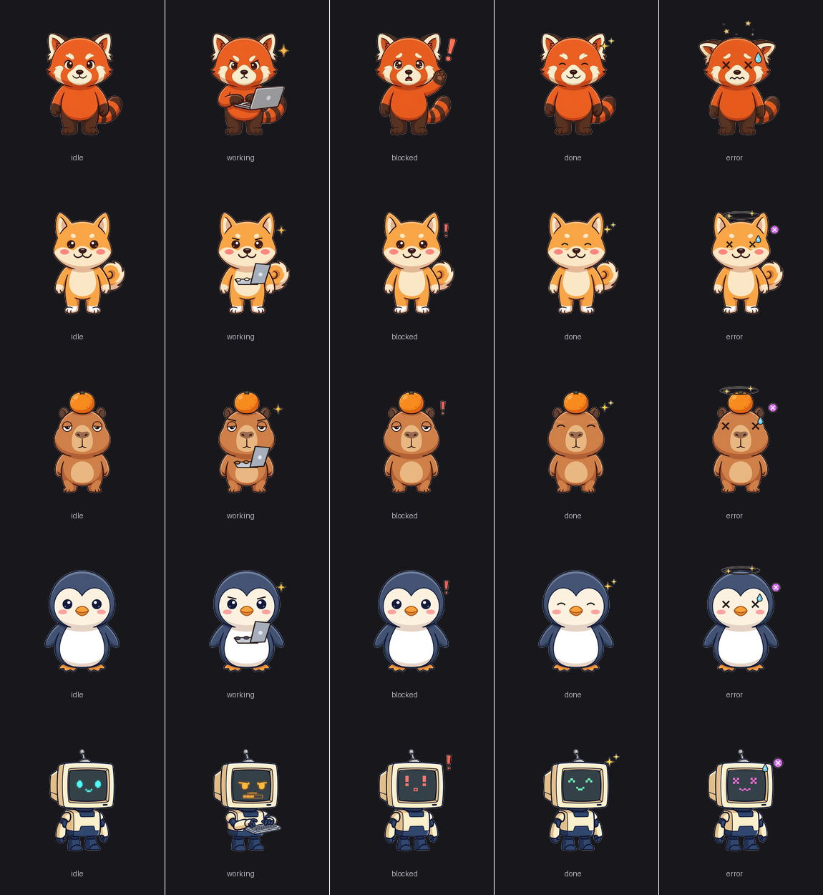

# Rex Pet 主题资源包 (`Themes/`)

这里包含 5 套可直接用于 `rex-pet` 的桌面宠物角色资源包，每套均包含 5 个状态（`idle` / `working` / `blocked` / `done` / `error`），每个状态为 16 帧、12 fps 的 `320×300` 透明通道 PNG 序列帧（带呼吸、眨眼、敲键盘弹跳、提示跳动、胜利跳跃、眩晕抖动等循环动画）。



## 包含角色

| 目录 | 角色 | 状态预览 |
| --- | --- | --- |
| `red-panda/` | 小熊猫 (Red Panda) | [preview](red-panda/preview.png) |
| `shiba/` | 柴犬 (Shiba Inu) | [preview](shiba/preview.png) |
| `capybara/` | 卡皮巴拉 (Capybara) | [preview](capybara/preview.png) |
| `penguin/` | 小企鹅 (Penguin) | [preview](penguin/preview.png) |
| `retro-robot/` | 复古 CRT 小机器人 (Retro Robot) | [preview](retro-robot/preview.png) |

## 如何切换使用

因为默认打包的 `RexPet.app/Contents/Resources/Assets/*.mov` 优先级高于纯 PNG 文件夹，使用辅助脚本将选定主题编码为 HEVC-with-alpha `.mov` 安装到 `~/Library/Application Support/rex-pet/Assets/` 即可立即覆盖默认鲸鱼娘，**不会修改仓库源码**：

```sh
./tools/install-theme.sh red-panda
./tools/install-theme.sh shiba
./tools/install-theme.sh capybara
./tools/install-theme.sh penguin
./tools/install-theme.sh retro-robot
```

恢复默认的鲸鱼娘：

```sh
./tools/install-theme.sh --restore-default
```

> 安装后，宠物会在下一次状态切换（或重启 `RexPet.app`）时自动加载新角色。
